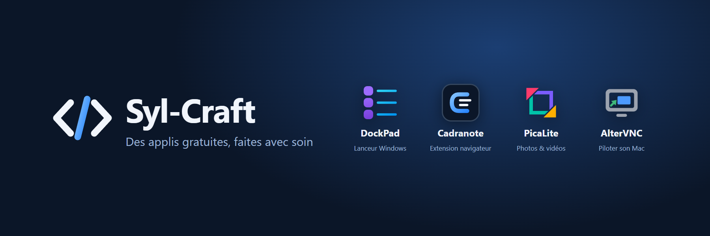
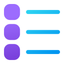

Développeur indépendant, je crée des applis gratuites.
*Indie developer building free apps.*

| | Appli | Plateformes | En bref | En cours |
|---|---|---|---|---|
|  | **[DockPad](https://github.com/syl-craft/DockPad)** |  | Barre de lancement rapide pour Windows · *Quick launch bar for Windows* |  |
|  | **[Cadranote](https://github.com/syl-craft/cadranote)** |    | Extension navigateur : cibler des éléments d'une page pour une IA · *Browser extension to target page elements for an AI* |  |
|  | **[PicaLite](https://github.com/syl-craft/PicaLite)** |  | Visionneuse et organiseur de photos et vidéos pour Windows · *Photo & video viewer for Windows* |  |
|  | **[AlterVNC](https://github.com/syl-craft/AlterVNC)** |   | Ton Mac depuis n'importe quel appareil : AlterVNC s'adapte à ton écran · *Your Mac from any device, on any screen* |   |
|  | **[Mue](https://github.com/syl-craft/Mue)** |   | Bibliothèque C# de mise à jour automatique pour applis .NET (WPF, Avalonia) · *Self-updates for .NET desktop apps* |  |

Si l'une d'elles te rend service, un café m'aide à continuer · *If one of them helps you, a coffee keeps me going*

